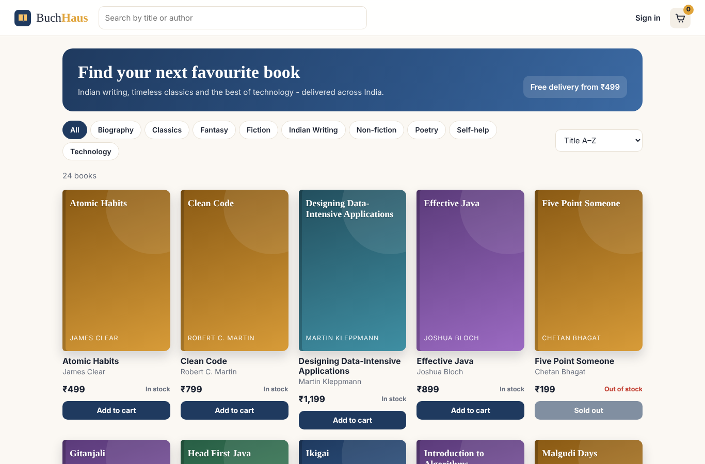
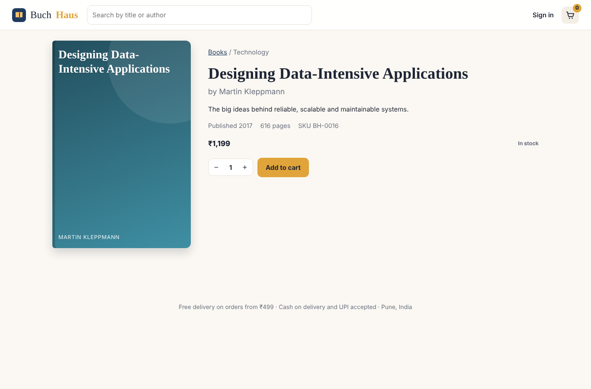
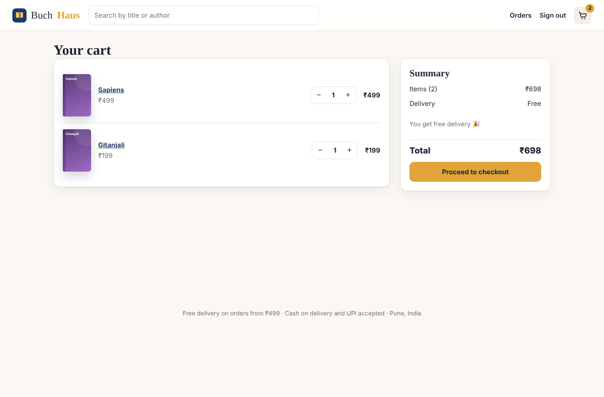
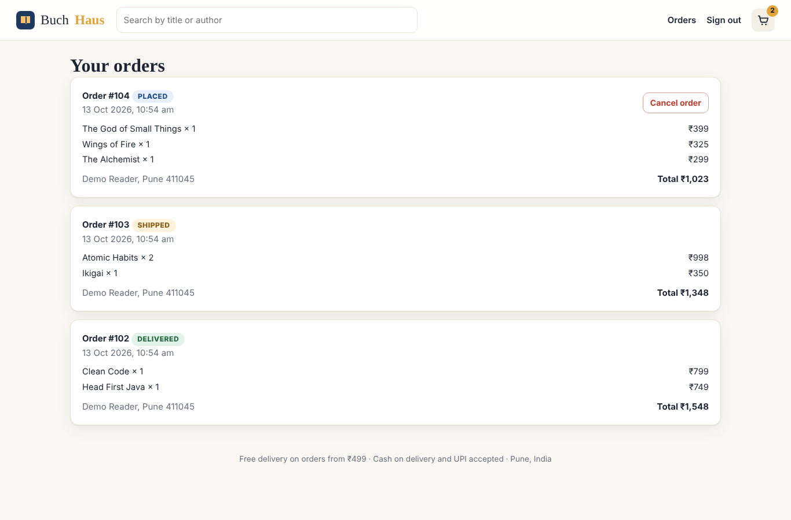
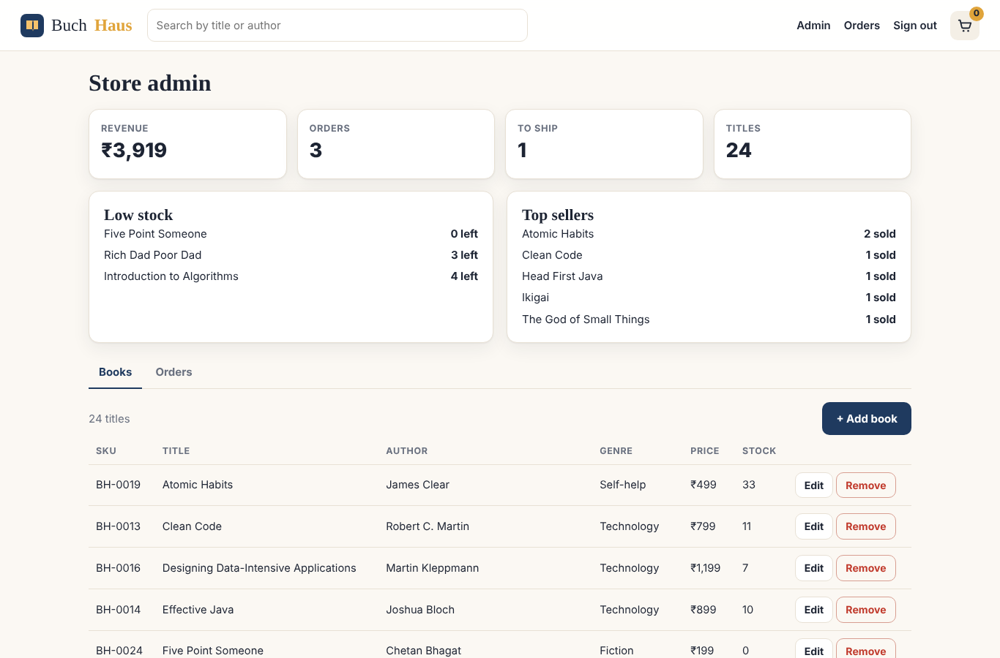
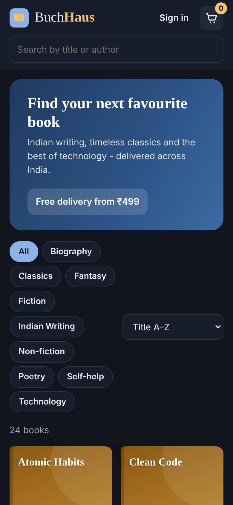
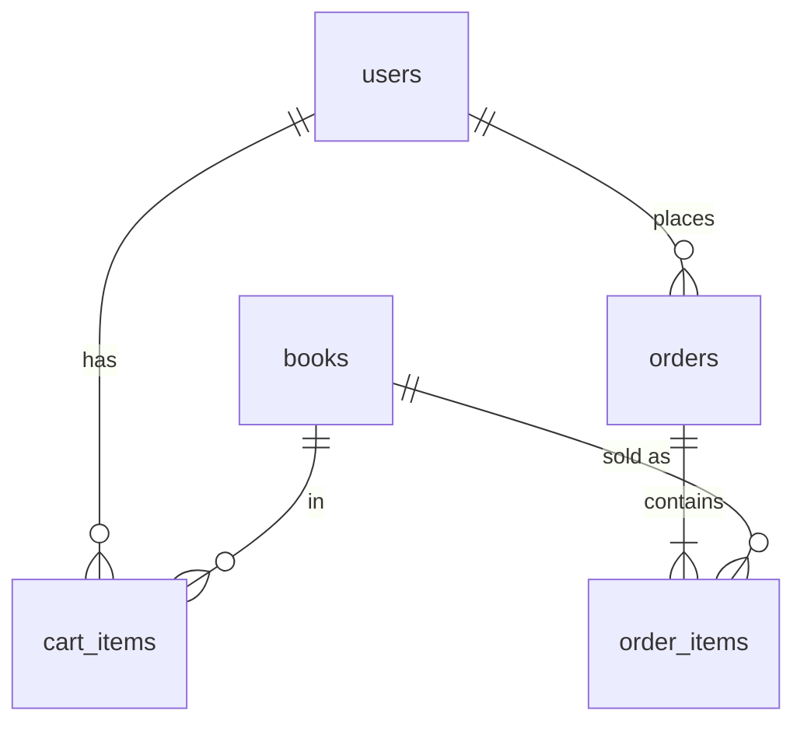

# BuchHaus

An online bookstore built with **Java 21 and Spring Boot 3**. Customers browse and search the catalogue, keep a server-side cart, and check out with a delivery address. Stock is enforced with **row-level locks**, so the last copy can only ever be sold once. Admins manage titles and move orders through their life cycle.

**Stack:** Spring Boot 3, Spring Security with JWT (customer and admin roles), Spring Data JPA, Flyway, MySQL 8 (H2 for development), and a responsive vanilla-JavaScript single-page front end.

**Tests:** 41 JUnit tests (unit, Mockito and MockMvc integration) and 14 Cypress end-to-end tests, run by GitHub Actions against H2, real MySQL and the packaged jar.



| Book page | Cart | Orders | Admin | Mobile (dark) |
|---|---|---|---|---|
|  |  |  |  |  |

---

## Features

**Customers**
- Catalogue of 24 titles across 9 genres:
  - search by title or author
  - genre filters
  - sorting by price, title or newest
  - pagination
- Book pages with stock status ("Only 4 left", "Sold out"). Covers are generated from the title, so no image files are needed.
- **Server-side cart** that survives logging out and switching devices. It shows a free-delivery progress bar (free from ₹499, otherwise ₹49) and flags lines that can no longer be bought.
- **Checkout** with an Indian address: validates a 10-digit mobile number and a 6-digit PIN code, and pays on delivery.
- Order history; customers can cancel an order until it ships, and the stock goes back on the shelf.

**Admins** (`ROLE_ADMIN`)
- Dashboard: revenue (cancelled orders excluded), orders by status, low-stock list and top sellers.
- Add and edit books, with optimistic locking: if two admins edit the same book, the second save is rejected instead of silently overwriting.
- Removing a book **deletes** it if it was never ordered, otherwise **retires** it (hidden from the shop, kept for order history).
- Move orders PLACED → SHIPPED → DELIVERED, or cancel them. Only valid transitions are offered.

## The interesting parts

**Checkout cannot oversell.** [`OrderService.checkout`](src/main/java/com/buchhaus/service/OrderService.java) runs in one transaction:
1. It locks every book in the cart with `SELECT … FOR UPDATE` (`@Lock(PESSIMISTIC_WRITE)`), always in id order so two checkouts can't deadlock.
2. It re-checks the stock under the lock and takes the copies.
3. It writes the order, then empties the cart.

If any line fails, nothing is committed. An integration test puts the last copy in two customers' carts: the first checkout succeeds and the second gets *409 "just sold out"*.

**Prices are historical facts.** Order lines snapshot the title and unit price at purchase time, so later catalogue edits never change past orders or revenue. All money is stored as whole **paise** (`BIGINT`), so totals never pick up floating-point errors. A database `CHECK` enforces `total = subtotal + shipping`.

**The order life cycle is an explicit state machine.** [`OrderStatus`](src/main/java/com/buchhaus/core/OrderStatus.java) defines the allowed moves:
- Customers may cancel only while an order is PLACED. Admins may also cancel a SHIPPED order.
- DELIVERED and CANCELLED are final.
- Cancelling restores stock under row locks.

**Security**
- Stateless JWT (HS256) carries the user's role.
- `/api/admin/**` requires `ROLE_ADMIN`; the catalogue is public, and cart and orders need sign-in.
- Every query is scoped to the caller, so another customer's order returns 404.
- Passwords are hashed with BCrypt. There's a strict Content-Security-Policy, and user text is inserted with `textContent` only.

## Architecture

```
src/main/java/com/buchhaus
├── core/        OrderStatus (state machine), Pricing (paise, shipping rule)
├── domain/      User, Book (@Version), CartItem, CustomerOrder, OrderItem
├── repository/  Spring Data repositories (search query, row locks, top-seller projection)
├── service/     AuthService, BookService, CartService, OrderService, AdminService
├── security/    JwtService, JwtAuthFilter (roles), SecurityConfig
├── web/         ShopController, AdminController, AuthController, DTO records, error handler
└── config/      StartupData (admin account, demo customer and orders), Clock, OpenAPI
src/main/resources/db/migration   V1 schema · V2 starter catalogue
src/main/resources/static         index.html · css/app.css · js/app.js · js/api.js
e2e/cypress                       catalogue, shopping and admin specs
```



## REST API

| Method | Path | Access | Purpose |
|---|---|---|---|
| POST | `/api/auth/register`, `/api/auth/login` | public | Get a JWT |
| GET | `/api/books?q=&genre=&sort=&page=&size=` | public | Search the catalogue (paged) |
| GET | `/api/books/{id}`, `/api/genres` | public | Book details, genre list |
| GET / DELETE | `/api/cart` | customer | View / empty the cart |
| PUT / DELETE | `/api/cart/items/{bookId}` | customer | Set quantity (0 removes) / remove |
| POST | `/api/orders` | customer | Check out with a delivery address |
| GET | `/api/orders`, `/api/orders/{id}` | customer | Order history |
| POST | `/api/orders/{id}/cancel` | customer | Cancel before shipping |
| GET | `/api/admin/stats` | admin | Revenue, orders by status, low stock, top sellers |
| GET / POST / PUT / DELETE | `/api/admin/books[/{id}]` | admin | Manage titles (DELETE retires books that were ordered) |
| GET / PATCH | `/api/admin/orders[/{id}/status]` | admin | List and filter orders, change status |

## Running it

```bash
mvn spring-boot:run          # http://localhost:8080 (H2 database, demo data)
```

| Account | Email | Password |
|---|---|---|
| Admin | admin@buchhaus.local | Admin@12345 |
| Demo customer | reader@buchhaus.local | reader1234 |

With Docker and MySQL 8:

```bash
cp .env.example .env         # set JWT_SECRET and a real ADMIN_PASSWORD
docker compose up --build
```

| Setting | Meaning |
|---|---|
| `JWT_SECRET` | HS256 signing key, at least 32 characters. **Always set this in production.** |
| `ADMIN_EMAIL`, `ADMIN_PASSWORD` | The admin account, created on first start if missing |
| `DEMO_DATA` | `true` creates the demo customer and three orders through the real checkout code |
| `SPRING_PROFILES_ACTIVE=mysql` + `DB_URL`, `DB_USER`, `DB_PASSWORD` | Use MySQL instead of H2 |

## Tests

```bash
mvn verify                                    # 41 JUnit tests + JaCoCo coverage report
cd e2e && npm install
CYPRESS_BASE_URL=http://localhost:8080 npx cypress run    # 14 Cypress tests (app must be running)
```

| Layer | Tests | What is covered |
|---|---|---|
| Core | 6 | State-machine transitions, free-delivery threshold, paise conversion, overflow guard |
| Services (Mockito) | 24 | Cart totals and stock limits; checkout stock and snapshots; re-checking stock under the lock; retired books; cancel restores stock; status rules; SKU conflicts; stale-version edits; retire vs delete; auth |
| Security | 4 | JWT round trip including role, tampering, wrong key, expiry |
| API integration (MockMvc, H2 and MySQL) | 7 | Public catalogue and search; 401 for guests and 403 for customers on admin routes; full purchase and cancel flow with stock checks; **last copy sold once**; address validation; admin order and book management; optimistic-lock conflict |
| End to end (Cypress) | 14 | Catalogue filters, sort, search and sold-out handling; registration form; cart → free delivery → checkout validation → order → cancel; stock cap; admin add and edit book, order life cycle; admin hidden from customers |

CI (`.github/workflows/ci.yml`) has four jobs:
- unit and integration tests on H2
- integration tests on MySQL 8
- Cypress against the packaged jar
- a Docker image build
